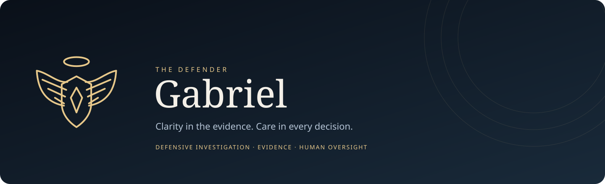
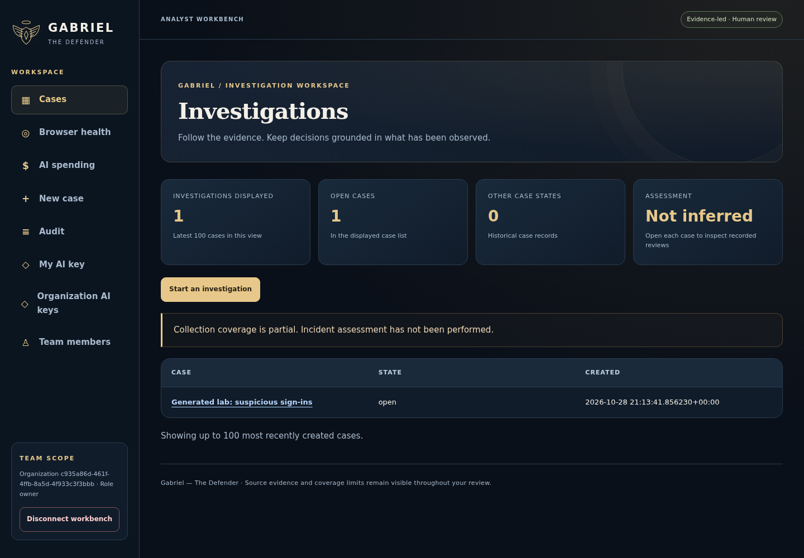

<p align="center"></p>

# Gabriel — The Defender

Gabriel is a defensive investigation workbench for security analysts. It brings cases, encrypted evidence, browser observations, specialist assessments and reviewed organizational knowledge into one workspace.

The interface uses Gabriel's own halo and winged-shield emblem, midnight-blue surfaces, pearl text and warm gold accents. Product graphics are maintained in [the Gabriel brand directory](docs/assets/gabriel/).

## Inside Gabriel



[View the updated dashboard, case overview, source health, Hermes and mobile screens](docs/assets/gabriel/workbench-updates/README.md). These five current workbench captures include verified source and screenshot hashes.

[View six earlier desktop and mobile screens](docs/assets/gabriel/screenshots/README.md). Captured with generated demo data; displayed features and limitations reflect the tested source.

[Explore investigation tools, analyst actions and the Hermes workflow concepts](docs/assets/gabriel/actions/README.md). Includes five actual generated-data screens and three clearly labeled design previews.

## Start here

- [Install the private Docker workbench](docs/readmes/GABRIEL_TEST_INSTALLATION.md)
- [Use the analyst workbench](docs/readmes/README.GABRIEL_WORKBENCH.md)
- [Pair the browser companion](docs/readmes/README.GABRIEL_BROWSER_CLIENT.md)
- [Review specialist agents and personal keys](docs/readmes/GABRIEL_SPECIALIST_AGENTS.md)
- [Review AI detection and activation status](docs/readmes/GABRIEL_BROWSER_AI_DETECTION.md)
- [Review cases and evidence](docs/readmes/README.GABRIEL_CASE_WORKFLOW.md)
- [Understand specialist assessments](docs/readmes/README.GABRIEL_SPECIALISTS.md)
- [Review browser investigation, learning and AI status](docs/readmes/GABRIEL_BROWSER_CAPABILITY_STATUS.md)
- [Review implementation and acceptance status](docs/readmes/GABRIEL_REQUIREMENT_STATUS.md)

## What is available

| Area | Current capability |
| --- | --- |
| Analyst workbench | Cases, assignments, investigation questions, evidence, timeline, provenance and metadata reports |
| Evidence | Encrypted storage, integrity checks, custody records and scoped content access |
| Browser companion | Up to eight paired tabs, popup-closed scheduled review, same-origin read-only discovery, changed-content capture, Pause and Stop |
| Specialists | Twelve designated AI-agent roles with bounded read-tool loops and personal analyst keys; exact model activation awaits qualification. Local-rule reviews remain available. |
| AI triage connection | Budgeted browser-to-model application bridge, minimized candidate signals and encrypted answers; production activation awaits qualification |
| Organizational knowledge | Automatic browser proposals, human review, approved-reference context in later reviews, expiry and forgetting controls |
| Operations | Owner enrollment, role-scoped access, audit history, spending controls and tested backup/restore paths |

The current source is a controlled manual-test candidate. Production AI qualification, operational/security acceptance and native Mac UAT remain open. Browser observations are partial; a heartbeat is not proof of uninterrupted visibility. Adding a provider key does not activate an unqualified model.

## Private Docker setup

Use Docker Engine/Desktop with Compose v2 and Python 3.9 or later on a supported POSIX host. Keep the installation directory outside the repository. Follow the full installation guide, including trusting only the installation's generated CA in a dedicated local browser profile.

```bash
python3 tooling/scripts/gabriel_install.py prepare "$HOME/gabriel-private-test"
python3 tooling/scripts/gabriel_install.py initialize "$HOME/gabriel-private-test" --organization 'My organization' --username owner
python3 tooling/scripts/gabriel_install.py open "$HOME/gabriel-private-test"
```

The owner password is entered privately. Open the displayed localhost HTTPS claim page and enter the single-use ticket. Ticket and session lifetimes, certificate handling, Stop, backup and restore are documented in the guide. Preserve existing installations and original encryption keys.

## Development

Gabriel's application code lives in `gabriel/`; its deployment compositions are `compose.gabriel*.yml`. Use the matching Docker gates for the component being changed. Never run host pytest or infer live-console acceptance from generated fixtures.

```bash
./gabriel.sh identity-test /absolute/private/identity-evidence
./gabriel.sh test /absolute/private/runtime-evidence
bash tooling/scripts/gabriel_browser_check.sh /absolute/private/browser-evidence
```

See [CONTRIBUTING.md](CONTRIBUTING.md), [SECURITY.md](SECURITY.md), [the operational notice](DISCLAIMER.md) and [upstream notices](UPSTREAM-NOTICES.md). Historical tooling and technical compatibility identifiers are retained where required; they are excluded from Gabriel's packaged defensive runtime.

## License and provenance

See [LICENSE](LICENSE) and [THIRD-PARTY-LICENSES.md](THIRD-PARTY-LICENSES.md). Upstream copyright and third-party notices remain intact. Gabriel's defensive behavior and release status are documented independently of inherited components.
