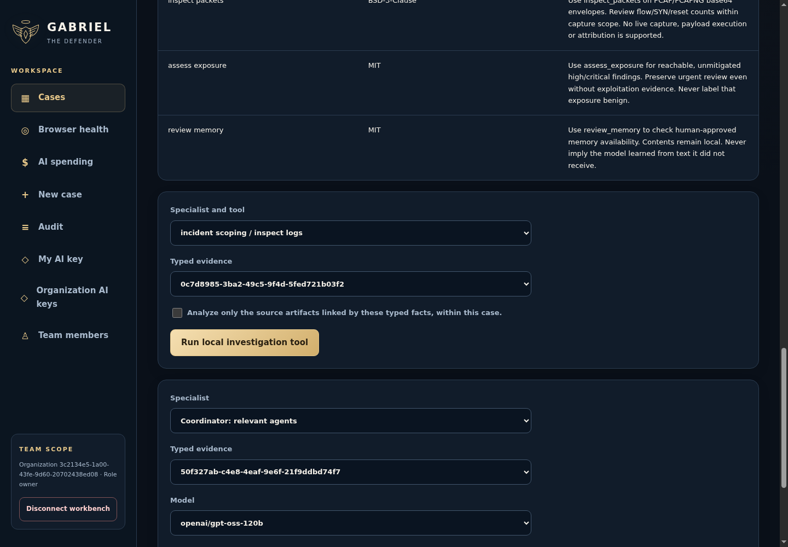
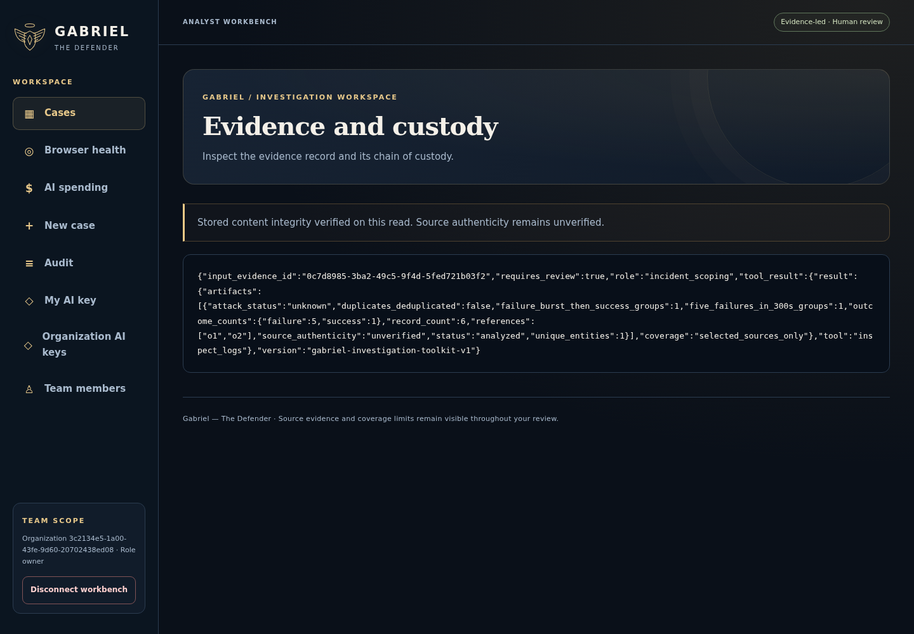
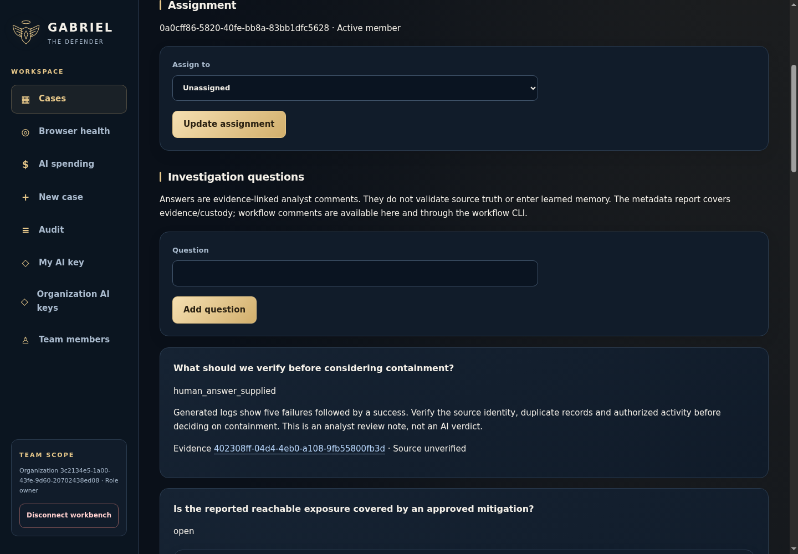
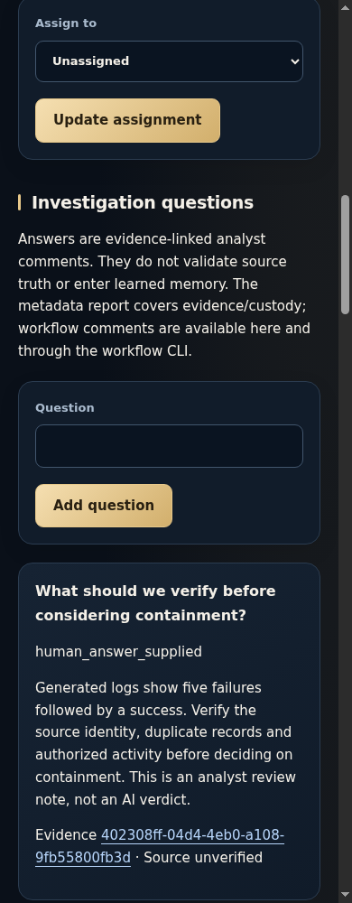
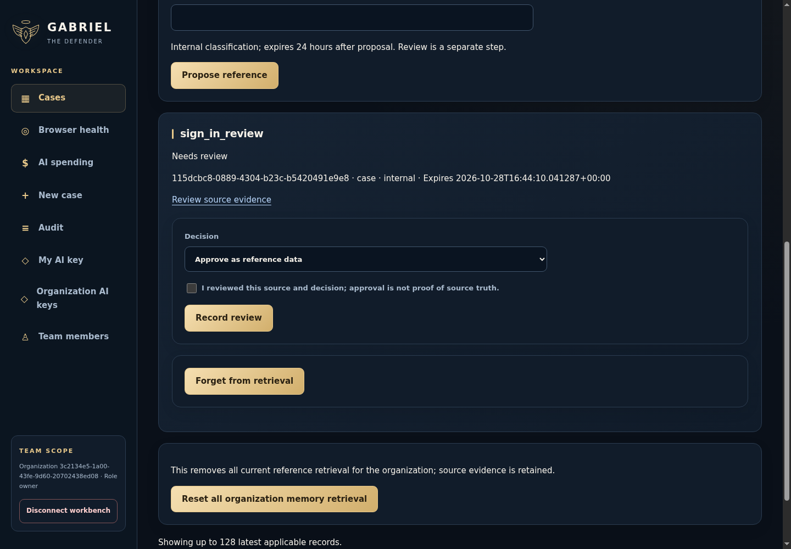
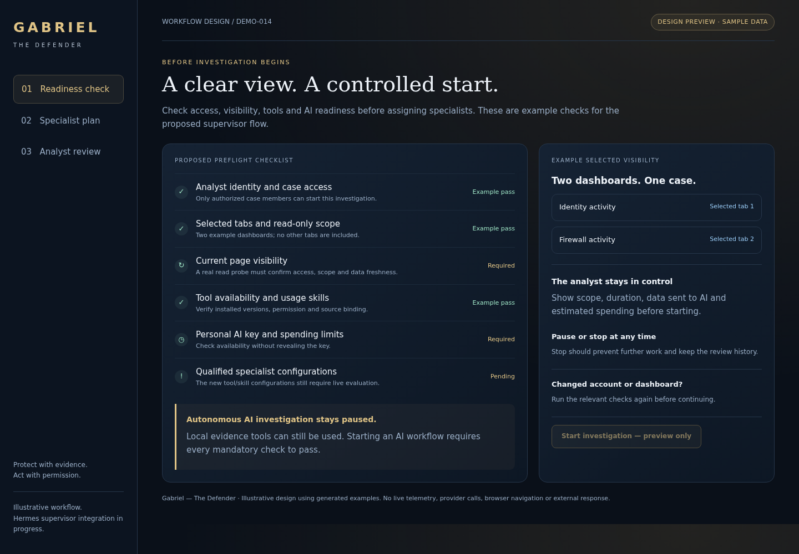
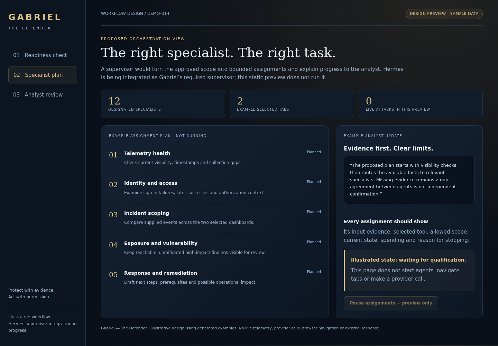
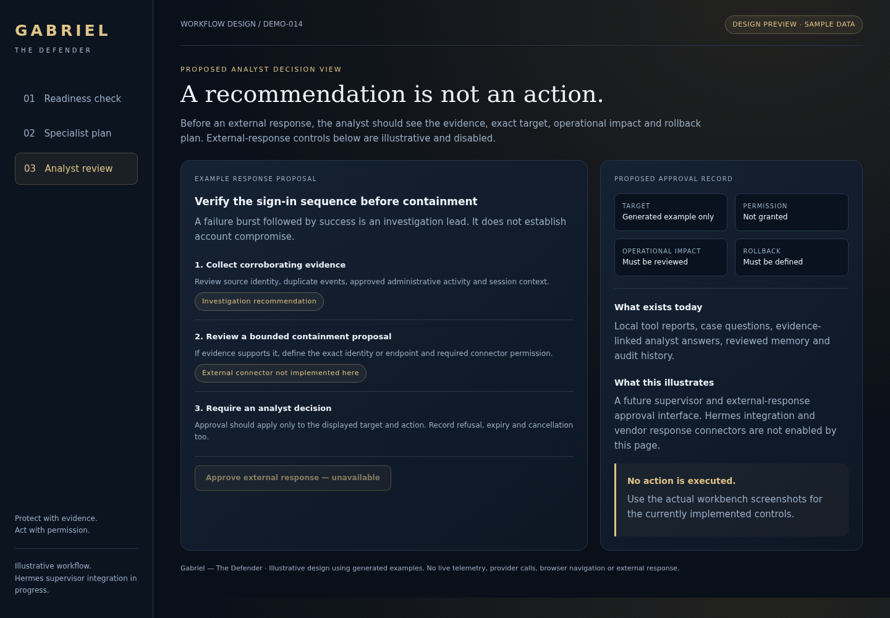

# Gabriel investigation and action gallery

Five actual workbench captures use generated data, an ephemeral PostgreSQL database, and the real isolated log parser. Three workflow concepts illustrate the required Hermes supervisor integration and analyst review. The concepts are labeled design previews; they do not perform investigation or response actions.

No real customer telemetry, provider credentials or paid model calls were used. These images do not establish production AI qualification. [Capture provenance and checksums](manifest.json) records the exact source and Docker CI artifact.

[Open the self-contained interactive workflow concept](../../../demos/gabriel-action-workflow.html). Download the HTML and open it locally to switch among the three views. It makes no network requests.

## Working screens

### Choose a specialist and run an allowed local tool

### Review the actual encrypted log-analysis result

### Assign ownership, record findings and ask the next question

### Review investigation questions on mobile

### Review a proposed reference before reuse

## Workflow concepts

Hermes is required by the product design. At this capture revision its runtime integration was still in progress. External response connectors and approval buttons in these concepts are unavailable.

### Preflight before autonomous investigation

### Supervisor assignments and analyst progress

### Proposed response and analyst approval

