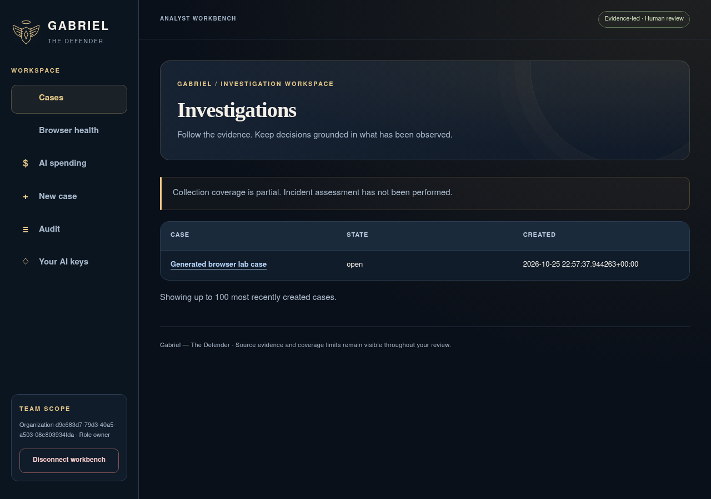
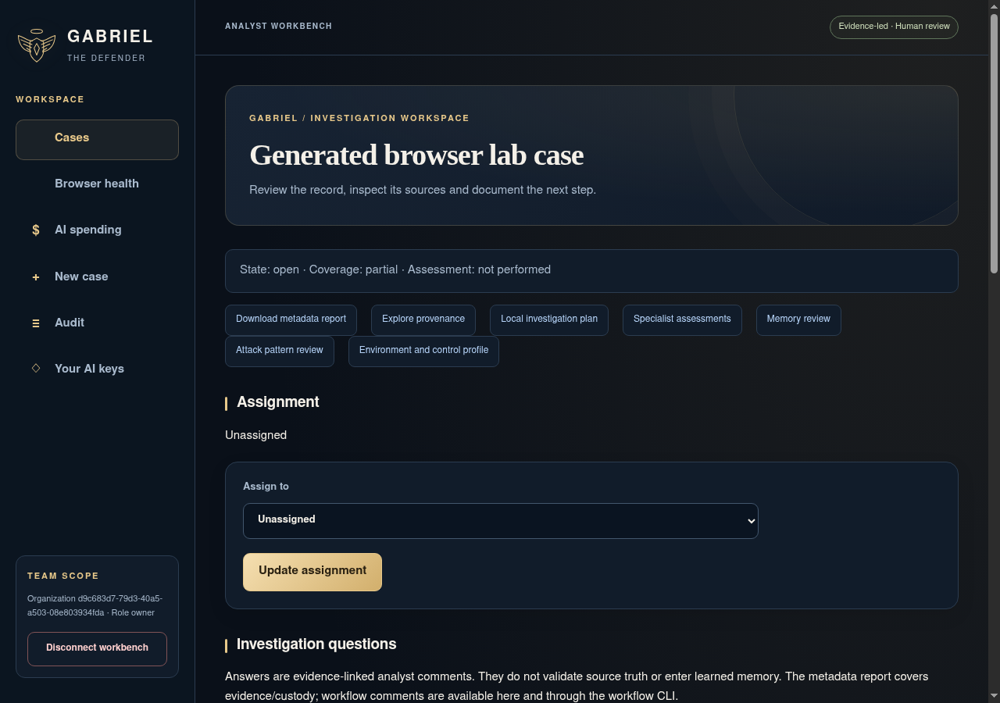
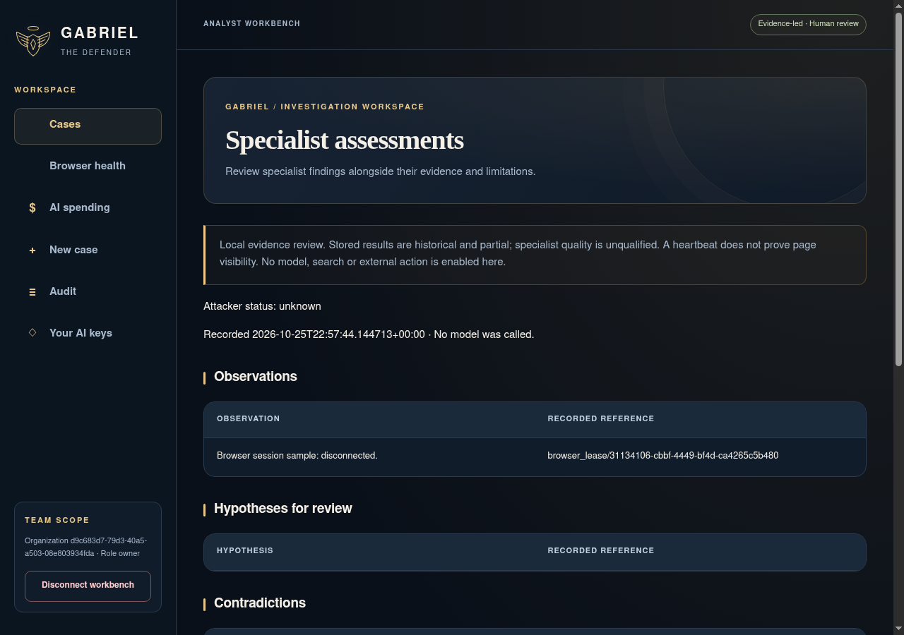
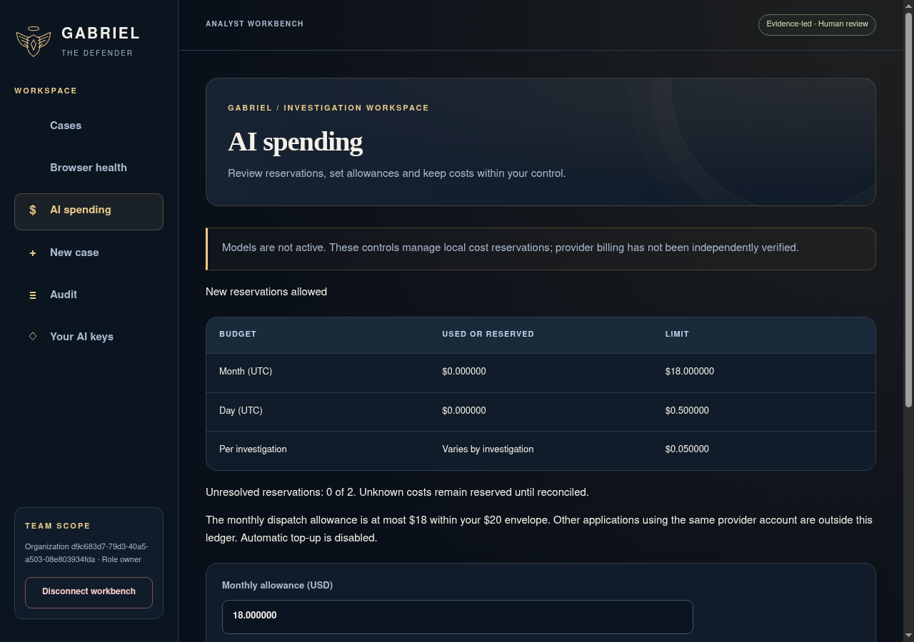
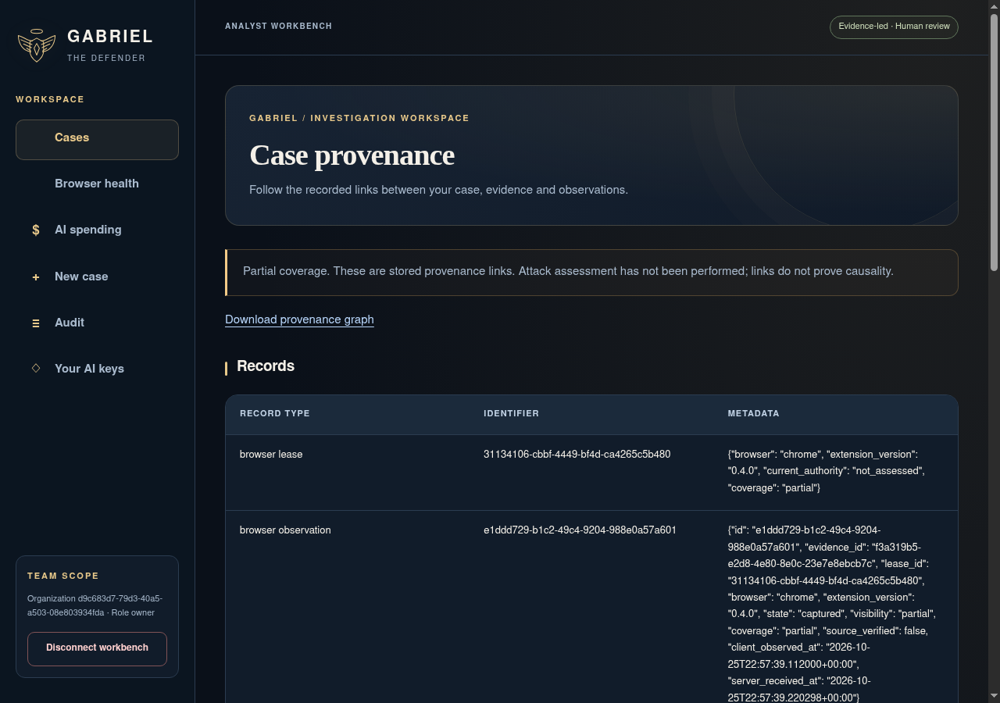
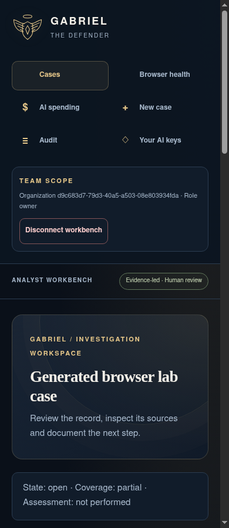

# Gabriel screen gallery

Actual Gabriel workbench screens captured in the isolated Chrome browser lab using generated data. These images demonstrate the interface; they do not establish production readiness, live threat detection or model qualification. The source checkout and image hashes are recorded in [manifest.json](manifest.json).

## Investigation queue

## Case workspace

## Specialist assessments

## Spending controls

## Case provenance

## Mobile layout

