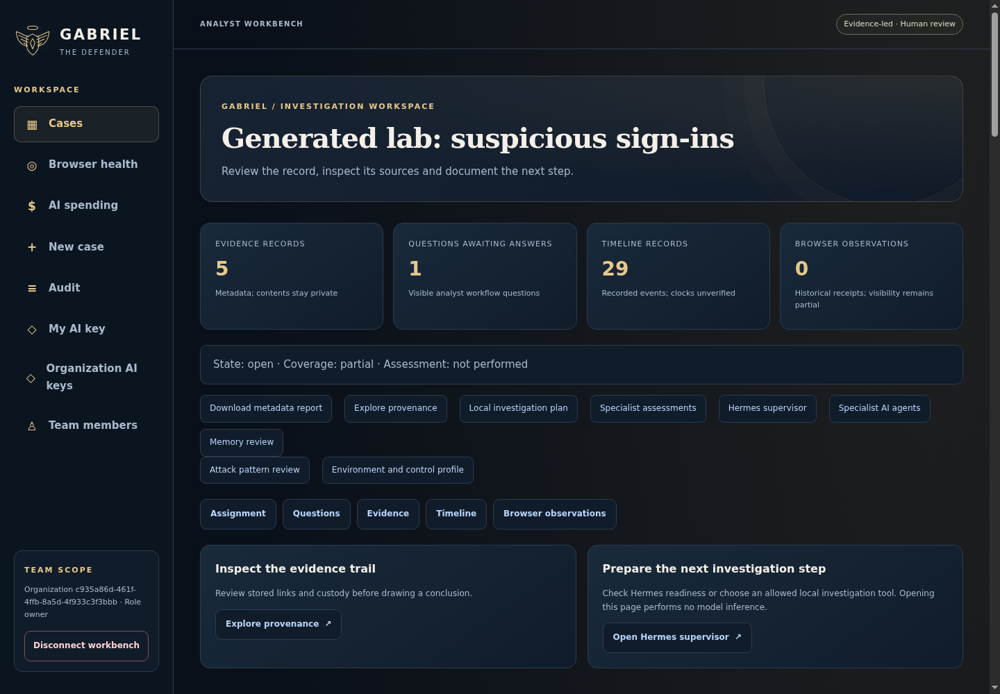
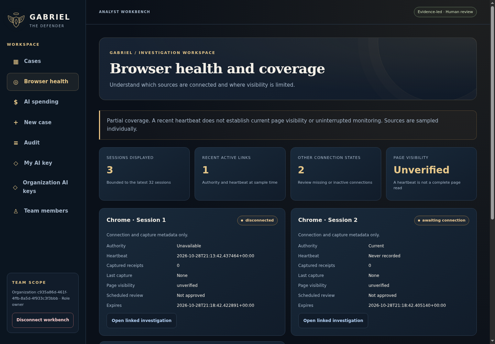
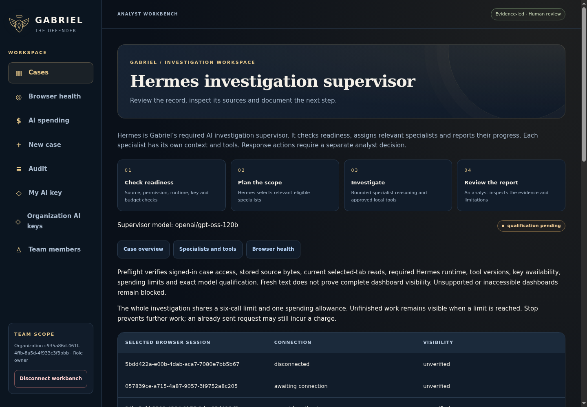
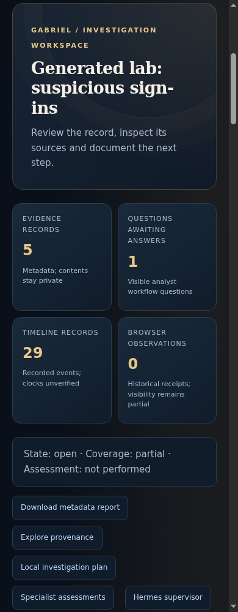

# Workbench UI updates

This gallery covers the implemented investigation dashboard, case summary, browser source-health cards, Hermes workflow and mobile layout. It uses generated records in the isolated Chromium/PostgreSQL screenshot lab. No customer evidence or paid model calls are used.

Counts describe only the bounded records displayed. Connection freshness does not establish current page visibility. Viewer-only question counts stay restricted. The Hermes workflow is a process map; actual recorded results and report links remain separate and require analyst review. Existing controls still require their original session, role and explicit POST consent.

Run the `Gabriel actual UI and action workflow gallery` workflow to reproduce the screens and metadata. Its `workbench-manifest.json` records five actual UI captures, source commit and SHA-256 hashes. Screenshots are illustrative software evidence; independent model quality and native-device/operational acceptance remain required.

## Actual screens

Captured from source merge `dc0869d88e60d774c79c94375f707b310ef30c79` (UI source `de4a66a7bcd931d84a35d50b7bcd356df0f45073`). [The retained manifest](manifest.json) records the original workflow, verified archive/image hashes and capture-source file hashes. Five focused behavior tests passed; Chromium checked horizontal overflow at 320px and 390px. No inference was performed.

### Investigation queue

### Case overview and next steps

### Browser health and coverage

### Required Hermes workflow

### Mobile investigation overview

