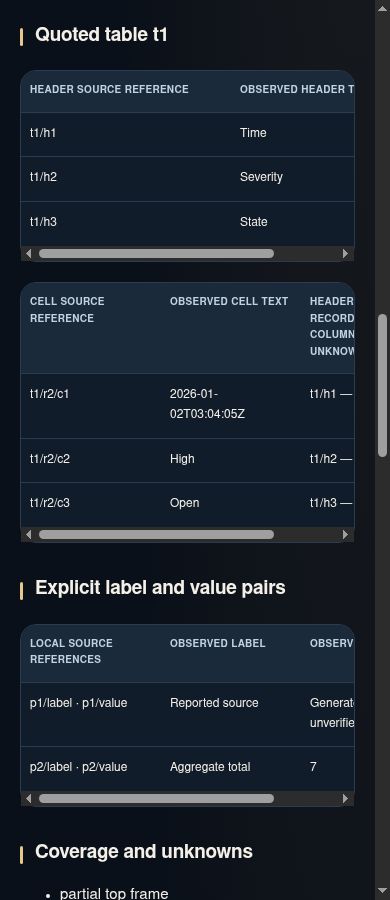
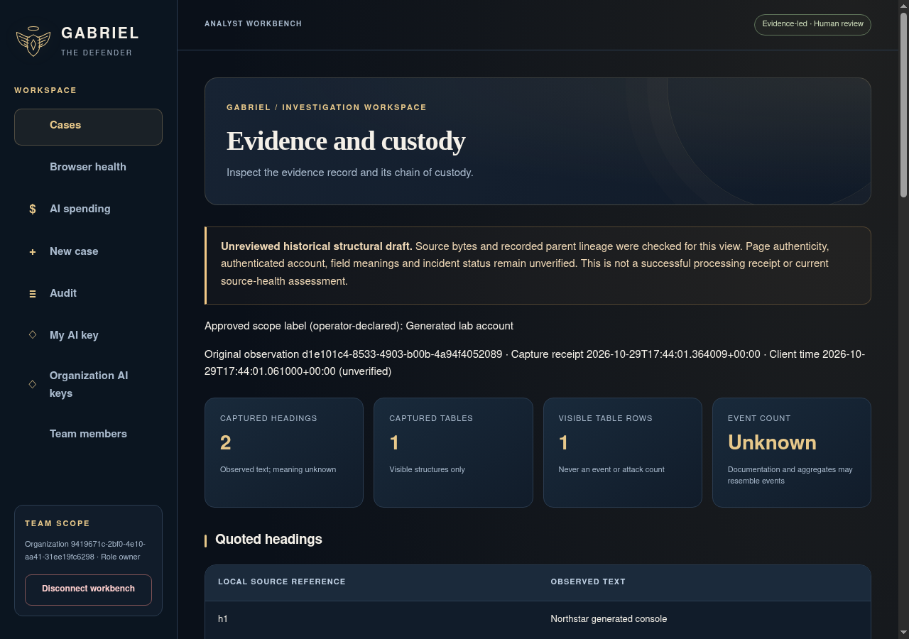
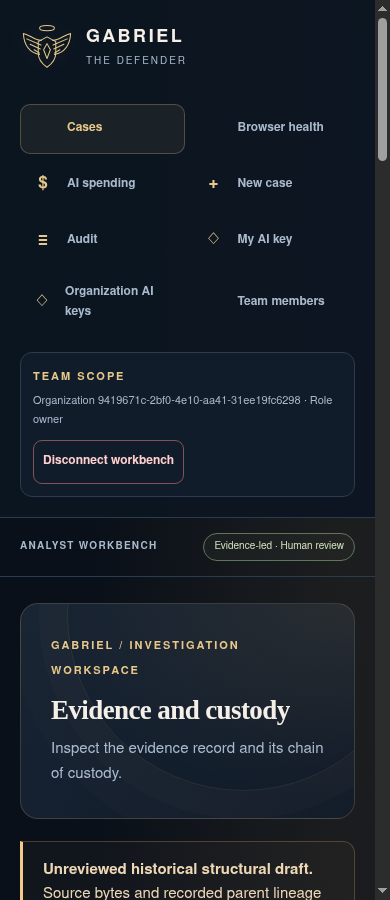

# Workbench UI updates

This gallery covers the implemented investigation dashboard, case summary, browser source-health cards, Hermes workflow and mobile layout. It uses generated records in the isolated Chromium/PostgreSQL screenshot lab. No customer evidence or paid model calls are used.

Counts describe only the bounded records displayed. Connection freshness does not establish current page visibility. Viewer-only question counts stay restricted. The Hermes workflow is a process map; actual recorded results and report links remain separate and require analyst review. Existing controls still require their original session, role and explicit POST consent.

Run the `Gabriel actual UI and action workflow gallery` workflow to reproduce the screens and metadata. Its `workbench-manifest.json` records five actual UI captures, source commit and SHA-256 hashes. Screenshots are illustrative software evidence; independent model quality and native-device/operational acceptance remain required.

## Actual screens

Captured from source merge `dc0869d88e60d774c79c94375f707b310ef30c79` (UI source `de4a66a7bcd931d84a35d50b7bcd356df0f45073`). [The retained manifest](manifest.json) records the original workflow, verified archive/image hashes and capture-source file hashes. Five focused behavior tests passed; Chromium checked horizontal overflow at 320px and 390px. No inference was performed.

### Investigation queue

### Case overview and next steps

### Browser health and coverage

### Required Hermes workflow

### Mobile investigation overview

## Visible structure review — Chrome and Brave

Six additional actual generated-data captures show the implemented authenticated historical structure view. The operator separately previews visible structure, approves sharing and explicitly requests quoted content. Recorded headings, ordinary table fields and definition-list pairs retain their source references. Page authenticity, account identity, field meanings and incident status remain unverified; captured rows are not an event count.

[Structure capture manifest](structure-manifest.json) pins implementation `518f7ae1570b27d93bd5de932ed3713ee193d2a1`, tested merge `4a47455786937b5b7f8d69e47946eeeb0552db27`, workflow [40923223065](https://github.com/emporiumtrading/redamon/actions/runs/40923223065), archive digest and all six PNG hashes. Each browser passed 110 named checks, including 20 structure checks. All six images were visually reviewed and verified against their manifests. These are Linux container captures with zero model calls, without native-device or production admission.

The 390px overview starts at the top navigation; the separate scrolled capture shows quoted fields. Wide tables scroll inside their own panels.

[Original Chrome source metadata](chrome-generated-structure-draft.json)

### Chrome — desktop

### Chrome — mobile overview

### Chrome — mobile quoted fields

[Original Brave source metadata](brave-generated-structure-draft.json)

### Brave — desktop

### Brave — mobile overview

### Brave — mobile quoted fields

